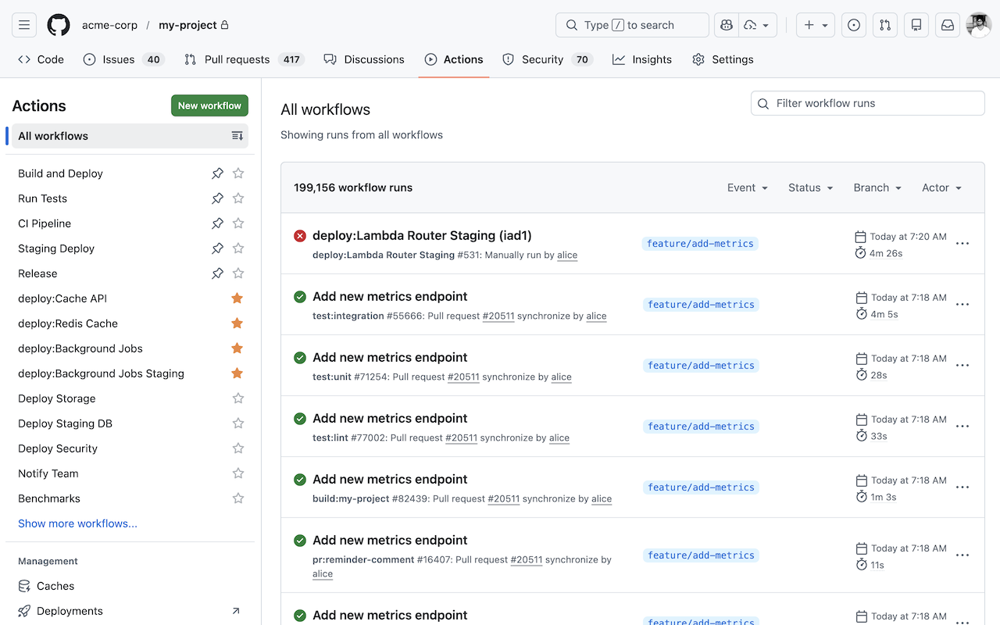

# Actions Wrangler

[](https://opensource.org/licenses/MIT)

A Chrome extension that helps you tame your GitHub Actions. Pin unlimited workflows beyond GitHub's 5-pin limit and get instant access to your favorites.



## Features

- **Unlimited Pinned Workflows** - Pin as many workflows as you need using the star icon (GitHub only allows 5)
- **Instant Access** - Pinned workflows appear immediately when the page loads, before GitHub finishes loading the full list
- **Manual Unfold** - Expand all workflows with one click using the unfold button next to "All workflows"
- **Auto Unfold** - Optionally enable automatic expansion of all workflows on page load
- **Per-Repository Pins** - Pins are stored separately for each repository
- **Synced Settings** - Your pins sync across devices via Chrome sync
- **Light/Dark Mode** - Icon automatically adapts to your system theme

## Installation

### From Chrome Web Store

Coming soon!

### From Source

1. Clone this repository:
   ```bash
   git clone https://github.com/kldavis4/actions-wrangler.git
   cd actions-wrangler
   ```

2. Install dependencies and build:
   ```bash
   npm install
   npm run build
   ```

3. Open Chrome and navigate to `chrome://extensions/`

4. Enable "Developer mode" (toggle in top right)

5. Click "Load unpacked"

6. Select the `dist` folder

## Usage

### Pinning Workflows

1. Navigate to any GitHub Actions page (`github.com/org/repo/actions`)
2. Hover over a workflow to reveal the star icon
3. Click the star to pin/unpin a workflow
4. Pinned workflows (orange star) appear at the top of the list, after GitHub's native pins

### Expanding All Workflows

- Click the unfold button next to "All workflows" to expand the full list
- Or enable "Auto Unfold" in the extension popup to expand automatically on page load

### Extension Popup

Click the extension icon to access:
- **Auto Unfold** toggle - Enable/disable automatic workflow expansion
- **Reset All Pinned Workflows** - Clear all extension pins across all repositories

## Development

### Scripts

```bash
npm run build      # Build for production
npm run watch      # Watch mode for development
npm run typecheck  # Run TypeScript type checking
npm run package    # Create distributable zip file
npm run clean      # Remove dist folder
```

### Building Icons

If you modify the SVG icons, regenerate the PNGs:

```bash
make clean && make
```

Requires `rsvg-convert` (install via `brew install librsvg` on macOS).

### Project Structure

```
actions-wrangler/
├── src/               # TypeScript source files
│   ├── content.ts     # Main content script
│   ├── background.ts  # Service worker
│   └── popup.ts       # Popup script
├── assets/            # SVG icons (source)
├── dist/              # Built extension (generated)
├── manifest.json      # Extension manifest
├── popup.html         # Popup UI
└── package.json       # Dependencies & scripts
```

## Permissions

- **storage** - Save pinned workflows and settings (synced via Chrome)
- **tabs** - Update extension icon based on current page

## Contributing

See [CONTRIBUTING.md](CONTRIBUTING.md) for development setup and guidelines.

## Privacy

This extension does not collect any personal data. See [PRIVACY.md](PRIVACY.md) for details.

## License

MIT
